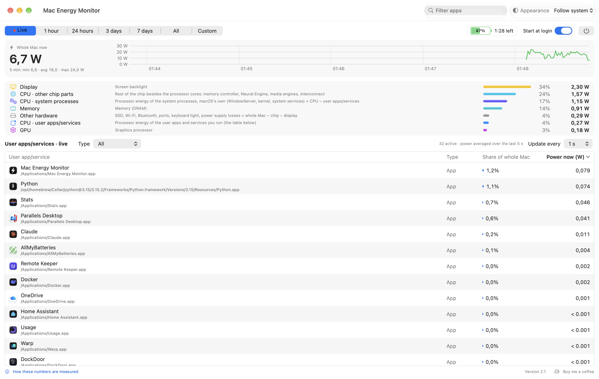
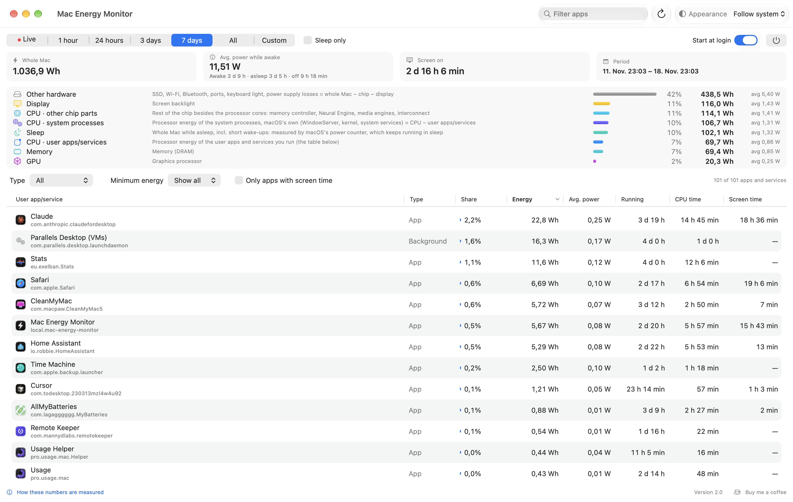
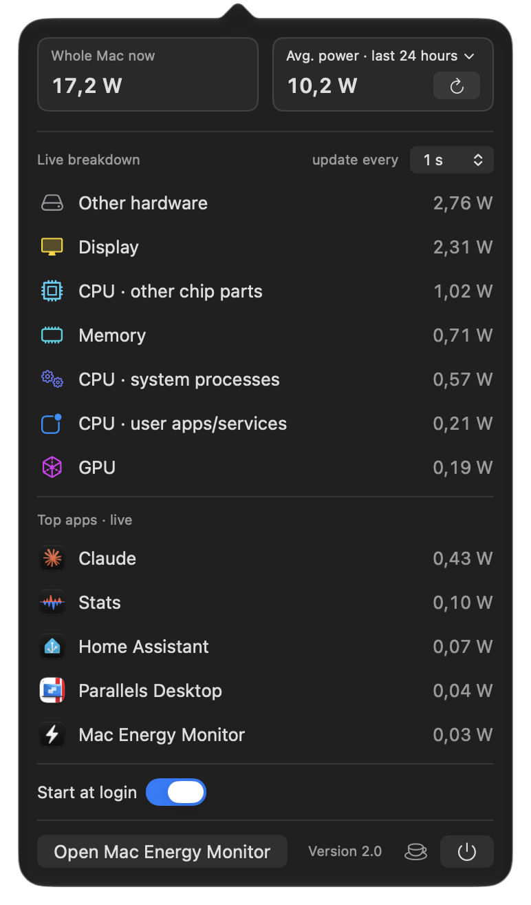
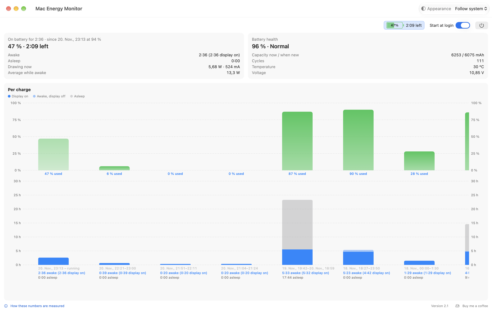
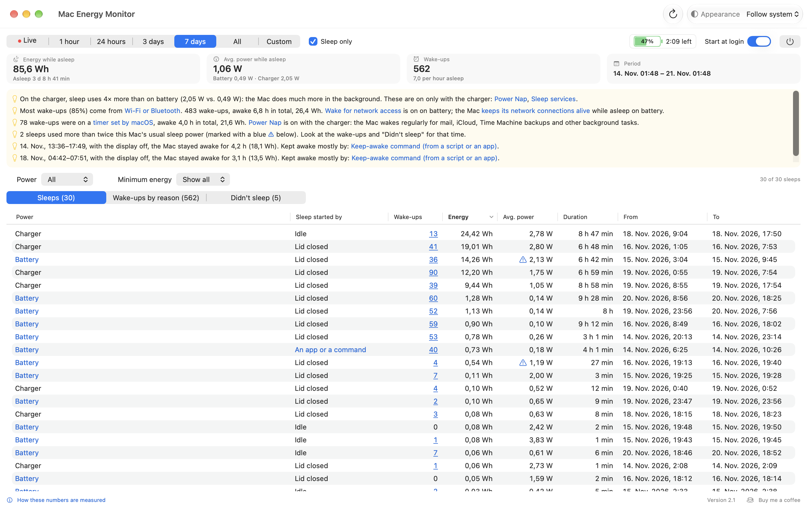

# Mac Energy Monitor

A small native menu bar app for Apple silicon Macs that shows **how much power your Mac uses right now, and where the energy went** over the last hour, days or weeks, per app and per part of the hardware.

- **Menu bar:** the whole Mac's power draw in watts, updated every second (or every 2, 5 or 10 s), and on Macs with a battery its charge with the time left or until full, or **Full** / **Paused** on the charger (monochrome; switch it off with **In menu bar** in the panel). Click it for a panel with the battery and **Start at login** at the top; it closes when you click anywhere else.
- **Live view:** a 5-minute chart, a breakdown into display, CPU (user apps/services and system processes), GPU, memory, the rest of the chip and other hardware, plus a table of the apps and services using power right now.
- **History:** 1 hour, 24 hours, 3 days, 7 days, all, or any custom period. Energy (Wh), average power while awake, how long the Mac was awake, asleep and switched off, screen-on time, the same hardware breakdown (including the energy used while asleep), and a sortable, filterable table of apps with energy, running time, CPU time and screen time.
- **Sleep only:** what the Mac did while it was asleep: the energy and average power of every sleep (on battery and on the charger), every wake-up grouped by reason (Wi-Fi or Bluetooth, timers set by macOS such as Power Nap, lid/keyboard signals, the charger), the times it stayed awake when it should have slept (lid closed or display off) and what kept it awake (highlighted, with a hint), and plain-language hints with the settings that matter. Filter by power source (battery or charger) and minimum energy: the cards, all tables and the hints then count only the matching sleeps. Click a sleep's number of wake-ups to see just its wake-ups by reason; hover over **Battery** in a sleep's row for its period, charge used, time asleep, energy and average power. Technical macOS names are shown in plain words; hover over a blue name for an explanation and the original macOS name or setting.
- **Battery:** the battery button in the window's top row shows the charge in %, ⚡ while charging, and the time left or until full. Click it for the battery view: a card with the current state (on battery, charging or on the charger, since when, awake with display on, asleep, switched off, power now) and a card with the battery's health. Below, a chart of every charge (newest on the left): the charge used, and how long the Mac was awake, had the display on, was asleep or switched off. Hover over a charge for its details. The time estimate is the app's own: the energy left divided by the average power of the last 5 minutes, and the time until full follows this Mac's own charging curve, learned from its log.
- **Long-term history:** macOS keeps its power logs for only about 10 days. The app saves a small summary of every finished day, so its history goes back as far as the app has been running.
- **Start at login** (hidden, menu bar only), light/dark appearance, and it remembers your views and filters.

No admin rights, no tracking. The only network access is an optional check for new versions on GitHub; everything else stays on your Mac.



<table>
<tr>
<td width="68%"></td>
<td width="32%"></td>
</tr>
<tr>
<td align="center"><sub>History (here 7 days)</sub></td>
<td align="center"><sub>Menu bar panel</sub></td>
</tr>
</table>





## Requirements

- A Mac with **Apple silicon** (M1 or later)
- **macOS 14 Sonoma or later**

It was developed and tested on an M1 Pro with macOS 27. Other chips and macOS versions use the same data sources with fallbacks, but haven't been tested on real hardware yet. Reports are welcome (see below).

## Install

1. Download `Mac-Energy-Monitor.zip` from the [Releases](../../releases) page and unzip it.
2. Move **Mac Energy Monitor.app** to your **Applications** folder.
3. Open it. The app is signed with an Apple Developer ID and notarized by Apple, so macOS only asks once whether you want to open an app downloaded from the internet. Click **Open**.

Prefer not to run a downloaded app? Build it yourself (next section). The result is the same.

## Updates

Click the version at the bottom of the window or the menu bar panel to open **About**, then **Check for Updates**. It shows what's new; **Download** asks where to save the new version (Downloads is suggested), saves it there already unpacked and checked, and tells you where it is (**Show in Finder**). Quit Mac Energy Monitor and drag the new app into your Applications folder (replace the old one); your settings and history are kept. To be told about new versions automatically, turn on **Check automatically every day** in About (off by default; it's the app's only network access).

## Build from source

You need Apple's free Command Line Tools (`xcode-select --install`) or Xcode. No Xcode project is required.

```bash
git clone https://github.com/vankov1976/mac-energy-monitor.git
cd mac-energy-monitor
./build.sh
```

The app is written to `build/Mac Energy Monitor.app`. Move it to `/Applications`. (A build of your own is signed only locally, which is fine on the Mac that built it.)

Maintainers: `tools/release.sh` builds the signed and notarized release zip (needs an Apple Developer ID certificate and a `notarytool` profile, see the script).

## Where the numbers come from

All data comes from what macOS already measures:

| What | Source |
|---|---|
| Whole Mac, live | The system management controller (SMC) power sensor |
| Display, live | SMC backlight power |
| CPU, GPU, memory, rest of the chip, live | The chip's energy counters (IOReport) |
| Apps, live | Per-process energy counters from macOS (`proc_pid_rusage`) |
| History | macOS's own power log (`/var/db/powerlog`, read-only) |
| Sleep energy | macOS's whole-Mac power counter, which keeps counting while the Mac sleeps; on battery, the battery's own charge before and after a sleep |
| Battery, live | The battery's own data (charge, capacity, current) and the SMC power sensors for the whole Mac and the charger |
| Battery, per charge | macOS's battery log (in `/var/db/powerlog`) checked against its sleep log |
| Sleeps, wake-ups, what kept the Mac awake | macOS's sleep log (`pmset -g log`, read-only); it reaches back about a week |

Some parts are **estimates**: for example "Other hardware" is what remains of the whole Mac after the chip and display, and history older than macOS's logs comes from the app's saved daily summaries. Click **"How these numbers are measured"** at the bottom of the window for the details.

## Uninstall

See [UNINSTALL.md](UNINSTALL.md) for every file the app creates and how to remove them. In short: switch off "Start at login" in the app first, then delete the app.

## Credits

The live chip readings on newer macOS versions use the method and counter IDs from [macmon](https://github.com/vladkens/macmon) by vladkens (MIT License). See [THIRD-PARTY-NOTICES.md](THIRD-PARTY-NOTICES.md).

## Support

Mac Energy Monitor is free and stays free for everyone. If it's useful to you and you'd like to say thanks, you can [buy me a coffee ☕](https://buymeacoffee.com/vankov1976). Completely optional, and much appreciated.

## Feedback

Found a bug, or tried it on another chip or macOS version? Please open an [issue](../../issues) and include your Mac model, chip and macOS version.

## License

[MIT](LICENSE)
